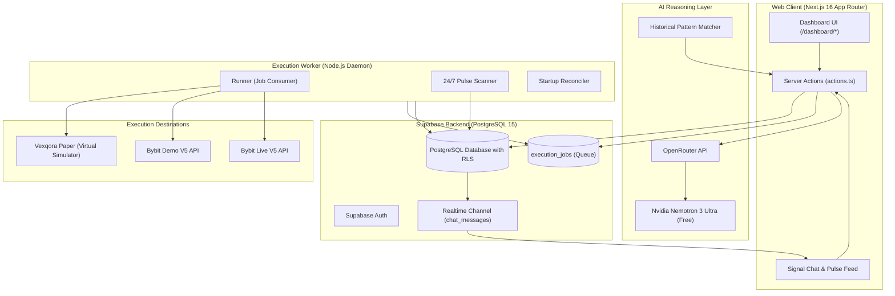
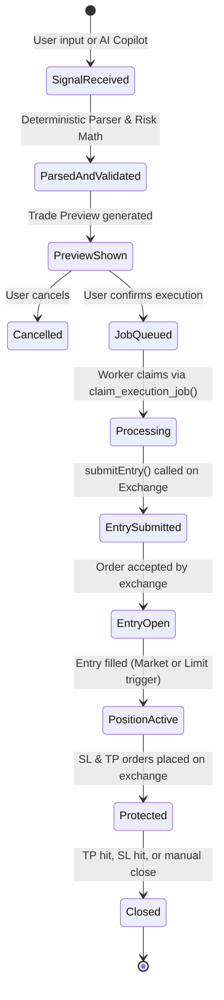

# Vexqora Trade — System Architecture & Specifications

This document describes the internal architecture, trade state machine, order lifecycle, security model, and data flow of Vexqora Trade.

---

## 1. High-Level System Architecture



---

## 2. Trade Execution Lifecycle & State Machine

Every trade transitions through well-defined states:



### State Definitions
- **`pending`**: Trade created in DB; preparing entry order.
- **`entry_open`**: Entry order submitted to exchange (waiting for fill if limit order).
- **`active`**: Entry order filled. Position is live on exchange.
- **`closed`**: Position closed (all TP targets hit, SL triggered, or manually exited).
- **`cancelled`**: Entry order cancelled before fill.

---

## 3. Order ID & Idempotency Convention

To prevent duplicate orders during network retries or worker restarts, all orders use a deterministic `orderLinkId` bounded to Bybit's character limit (max 36 chars):

| Order Purpose | `orderLinkId` Format | Example |
| :--- | :--- | :--- |
| **Entry Order** | `entry-${tradeId.slice(0, 30)}` | `entry-7f3c1a84-2e9b` |
| **Take Profit 1** | `tp1-${tradeId.slice(0, 29)}` | `tp1-7f3c1a84-2e9b` |
| **Take Profit 2** | `tp2-${tradeId.slice(0, 29)}` | `tp2-7f3c1a84-2e9b` |
| **Stop Loss** | `sl-${tradeId.slice(0, 31)}` | `sl-7f3c1a84-2e9b` |

---

## 4. Security & Cryptographic Boundary

### Exchange Secret Encryption (AES-256-GCM)
- Implemented in: `packages/exchange/src/crypto.ts`.
- Algorithm: **AES-256-GCM** with a 12-byte initialization vector (IV) and a 16-byte authentication tag.
- Serialized format: `ivHex:authTagHex:ciphertextHex`.
- Master key: 32 bytes (256 bits), stored as Base64 in `ENCRYPTION_MASTER_KEY`.
- Invariant: **Plaintext API keys and secrets are NEVER returned to client-side code and NEVER logged in console or log files.**

### Supabase RLS Separation
- **Web App**: Uses `NEXT_PUBLIC_SUPABASE_ANON_KEY` + User Session cookies. Every table access is constrained by `auth.uid() = user_id` or account ownership checks.
- **Worker**: Uses `SUPABASE_SERVICE_ROLE_KEY`. Only the worker process has administrative privileges to claim cross-user queued jobs and update execution statuses.

---

## 5. Design System Tokens

Located in `apps/web/src/app/globals.css`:

```css
:root {
  --bg-dark: #07050F;          /* Application background */
  --panel-dark: #0E0B1A;       /* Panel / sidebar background */
  --card-dark: #171229;        /* Card & input surface */
  --border-color: #2A2145;     /* Structural borders */
  --text-main: #F1EEFF;        /* Primary typography */
  --text-dim: #A59CC4;         /* Secondary / muted typography */
  --accent-purple: #7C4DFF;    /* Brand accent */
  --accent-gradient: linear-gradient(135deg, #7C4DFF 0%, #B24BFF 100%);
  --neon-green: #35F2D0;       /* Long, profit, TP badges */
  --neon-pink: #FF4F9A;        /* Short, loss, SL badges */
  --neon-yellow: #FFC24B;      /* Warning, trailing stop */
  --soft-violet: #B9A2FF;      /* Demo, links, timestamps */
}
```

- **Interface Font**: `Plus Jakarta Sans`, sans-serif
- **Data / Numeric Font**: `JetBrains Mono`, monospace
